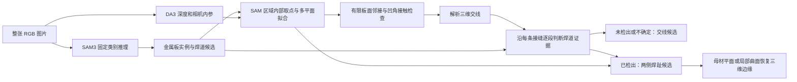

# QuadWeld：第一版视觉轨迹与机械臂控制

在 `plan.md` 第一阶段控制器上，将感知改为机身固定 RGB-D：采集对齐的 RGB 和深度 → 检测闭合轮廓或开放线条 → 深度点云 RANSAC 拟合板面 → 恢复三维路径 → 用安装标定变换到机械臂基座系 → 生成粗轨迹 → IK 预检查 → 接近、下降、沿线运动、抬起。**生成轨迹不读取 USD 的钢板位置、法向、尺寸或角点**，深度不可用时终止。本版是静态观测后执行，尚未实现移动中的在线重规划。

## 拼板与开口盒子

现在可直接在 Isaac Sim 中创建两种工件：`--workpiece plate-grid` 为多个独立方板组成的拼板，`--workpiece open-box` 为底板和四面侧壁组成的开口盒子。省略参数时仍使用原来的 `outline` 黑色轮廓示例。

新工件自动进入**场景预览与 RGB-D 采集模式**：机械臂初始化到拍照用的 home 姿态，随后保持，不执行焊缝识别或沿线运动。当前检测器不支持拼板的交叉分支，单平面规划器也未处理盒壁；因此新工件不能与 `--plan-only` 或 `--demo-open` 一起使用。

进入 `quadweld` 环境后，通过 Windows WebRTC 客户端观看（两条命令分别运行，切换前退出上一实例；GPU 编号按本机空闲情况调整）：

```bash
# 2×2 方板，真实 3 mm 间隙；连接后可直接查看
python main.py --workpiece plate-grid --webrtc --auto-start --gpu 1 --output-dir outputs/runs/plate_grid

# 开口盒子，观察底板与侧壁的交接处
python main.py --workpiece open-box --webrtc --auto-start --gpu 1 --output-dir outputs/runs/open_box
```

也支持 `--robot rm65`。去掉 `--auto-start` 后，在串流面板点击 **Capture RGB-D** 或在终端按回车，才初始化机械臂并采集图像。使用本地图形界面时去掉 `--webrtc`；只生成、拍照并退出时将其替换为 `--headless`。

| 参数 | 默认值 | 含义 |
| --- | --- | --- |
| `--grid-count` | `2` | 每一边的板件数，总共 N×N 块 |
| `--tile-size` | `0.20` | 单块正方形板边长，米 |
| `--seam-gap` | `0.003` | 相邻板之间的真实间隙，米 |
| `--wall-height` | `0.12` | 盒内底面到侧壁顶端的高度，米 |
| `WorkpieceConfig.thickness_m` | `0.006` | 板件厚度，米，在 `config.py` 设置 |
| `WorkpieceConfig.box_size_m` | `0.40` | 盒子外部边长，米，在 `config.py` 设置 |

例如生成 3×3 拼板，保持整体尺寸接近默认工件：

```bash
python main.py --workpiece plate-grid --grid-count 3 --tile-size 0.14 --seam-gap 0.004 \
  --headless --gpu 1 --output-dir outputs/runs/plate_grid_3x3
```

默认拼板外尺寸为 `0.403 × 0.403 m`，盒子外尺寸为 `0.40 × 0.40 × 0.126 m`（包含底板厚度）。每块板具有独立静态碰撞体，盒内空腔保留。拼板下方有支撑垫，间隙不是用黑色几何条填出来的；缝中深度可能来自下面的支架。材质为简单金属材质，并增加斜上方区域光。这些是理想几何工件，尚未加入锈蚀、坡口、焊道或加工纹理。

每次运行保存 `workpiece.usda`（独立、可复用的工件）、`quadweld_scene.usda`（包含机器人与相机的完整场景）、`body_rgb.png`、`body_depth_m.npy` 和 `body_depth_preview.png`。配置保存在 `robot_config.json` 的 `workpiece` 字段中。`execution_report.json` 的 `status=scene_only` 表示预览，不代表完成焊接任务。

两份默认资产也保存在 [assets/workpieces/](assets/workpieces/README.md)，可直接导入其他 Isaac Sim 场景。资产使用米、Z 向上，默认根节点为 `/Workpiece`；原点为拼板上表面中心或盒内底面中心。独立资产不含相机、灯光和底座，不依赖外部贴图。建模尺寸仅供场景生成使用，没有传给感知或轨迹生成器。

本次验证通过 27 项 CPU 测试，并在 Isaac Sim 6 / RTX 3090 上生成两种工件的 RGB-D。拼板同时验证了 WebRTC 服务与预览面板启动，盒子验证了无界面采集，均正常退出；客户端实际视频接收仍取决于网络连接。原矩形场景回归通过 106 个路径采样点、179 个运动目标的视觉与 IK 预检查，本次未重复沿线执行。预览图片见 [拼板](outputs/runs/plate_grid/body_rgb.png) 和 [盒子](outputs/runs/open_box/body_rgb.png)。

## 场景参数

所有位置和尺寸使用米；世界坐标系为 Z 轴向上。默认使用 UR5e，以下为其场景参数；RM65 的独立配置见下文。

| 对象 | 参数 |
| --- | --- |
| UR5e 固定底座 | 世界位置 `(0.45, -0.62, 0.45)`；下方有 `0.26 × 0.26 × 0.45` 支座；官方资产 `/Isaac/Robots/UniversalRobots/ur5e/ur5e.usd` |
| 钢板 | 中心 `(0.45, 0, 0.50)`；长 × 宽 × 厚 `0.80 × 0.60 × 0.01`；上表面 `z=0.505` |
| 黑色矩形 | 位于钢板中央；外尺寸 `0.30 × 0.20`；线宽 `0.008`；线条高出钢板 `0.0001` |
| 机身 RGB-D | 相对机械臂基座位置 `(0, 0.12, 0.55)`，向前下方观察；`640 × 480`，`fx=fy=400 px`；安装与内参见 `calibration/body_rgbd.json` |
| TCP 离板间隙 | `0.01`；工具 +Z 指向钢板，姿态固定 |
| 简化工具长度 | 法兰到 TCP 为 `0.12`，与离板间隙分别配置 |
| 路径 | 间距不超过 `0.01`；接近与抬起高度为钢板上方 `0.10` |
| 速度上限 | TCP 插值时间按 `0.04 m/s` 设置；关节 `0.5 rad/s`、`1.0 rad/s²` |

相机 prim 为 `/World/RobotMount/Sensors/BodyRGBD`，与机械臂共享安装座，模拟将来的机身安装关系；目前没有四足模型。上述工件参数仅用于生成测试场景。相机安装变换来自独立标定文件，仿真按该文件放置传感器，算法也以该文件作为输入。实机需要测量相机内参和相机到机械臂基座的外参，不能直接沿用示例数值。机身整体位置无需已知，只要相机与机械臂基座保持刚性连接，外参就不随狗的整体移动改变；但本版要求采集到执行结束期间相对工件保持静止。

## 运行

需要支持 RTX 光线追踪的 NVIDIA GPU、可用驱动，以及 **Isaac Sim 6.0**。本机使用全小写的 `quadweld` Conda 环境（Python 3.12）。首次安装可按 [NVIDIA 的 Python 环境说明](https://docs.isaacsim.omniverse.nvidia.com/6.0.0/installation/install_python.html) 执行：

```bash
conda create -n quadweld python=3.12 pip -y
conda activate quadweld
python -m pip install --upgrade pip
python -m pip install torch==2.11.0 --index-url https://download.pytorch.org/whl/cu128
python -m pip install 'isaacsim[all,extscache]==6.0.0.1' --extra-index-url https://pypi.nvidia.com
```

进入项目目录后，有界面运行：

```bash
conda activate quadweld
cd /data/huangliqi/QuadWeld
python main.py
```

### 切换机械臂

通过 `--robot ur5e|rm65` 选择机器人，省略时使用 UR5e。两者共用 RGB-D 感知、轨迹生成和控制流程：

```bash
# RM65：无界面执行完整任务
python main.py --robot rm65 --headless --gpu 4 --output-dir outputs/runs/rm65

# RM65：通过 Windows WebRTC 观看，连接后点击 Start task
python main.py --robot rm65 --webrtc --gpu 4 --output-dir outputs/runs/rm65

# 切回 UR5e
python main.py --robot ur5e --webrtc --gpu 4 --output-dir outputs/runs/ur5e
```

串流命令每次只运行一个实例。机器人在启动时选择，切换需要退出当前进程后重新启动。`--plan-only`、`--demo-open` 和 `--path-mode` 对两种机器人均适用。RM65 开放 U 形路径也已通过视觉与 IK 预检查（42 个路径采样点、103 个运动目标），结果见 `outputs/runs/rm65_open_validation/`。

| 配置 | UR5e | RM65-6F |
| --- | --- | --- |
| USD | Isaac Sim 官方 UR5e 资产 | `assets/robots/rm65/RM65-6F/RM65-6F.usda` |
| 末端连杆 | `wrist_3_link` | `link_6` |
| 基座世界位置 | `(0.45, -0.62, 0.45)` | `(0.45, -0.38, 0.60)` |
| 测试矩形尺寸 | `0.30 × 0.20 m` | `0.20 × 0.10 m` |
| 相机标定 | `calibration/body_rgbd.json` | `calibration/rm65_body_rgbd.json` |
| 关节驱动刚度 / 阻尼 | `100000 / 5000` | `10000 / 500` |

RM65 的安装座更近、更高，测试轮廓更小，以满足当前工具朝下姿态的可达范围；这些配置只决定仿真测试场景，轨迹仍由视觉观测生成。各自的 home 关节角定义在 `config.py`，拍照时避开任务轮廓。RM65 相机相对基座位于 `(0, 0.08, 0.55)`，向前下方观察。

RM65 暂以 `link_6` 原点作为工具安装原点，沿其 +Z 添加 120 mm 简化工具。实际工具需校准 `flange_translation`、`flange_quaternion_wxyz` 和 `tool_length_m`；示例相机外参也需替换为实测标定。

`--robot-usd /path/to/model.usda` 只覆盖所选机器人的资产路径，不自动识别机型；RM65 应同时指定 `--robot rm65`。`--calibration /path/to/calibration.json` 可覆盖该机器人的默认相机标定。RM65 资产来源及目录说明见 [assets/README.md](assets/README.md)。

无界面执行完整一圈并退出：

```bash
conda activate quadweld
cd /data/huangliqi/QuadWeld
python main.py --headless
```

用 `--gpu 4` 等参数指定一张 GPU（默认 GPU 0，关闭多 GPU 渲染）。只检查视觉与整条 IK 路径、暂不执行任务运动：

```bash
python main.py --headless --plan-only
```

`--plan-only` 与 `--scene-only` 都会将机器人初始化到拍照用的 home 姿态。`--scene-only` 随后仅拍照，不规划或执行路径。
默认 `--path-mode auto` 自动区分闭合轮廓和开放线条，也可用 `--path-mode closed` 或 `--path-mode open` 限定类型。运行 `python main.py --headless --plan-only --demo-open` 会把测试矩形改成开放 U 形线，用于检查端点到端点规划。
除 Isaac Sim 外，算法使用 NumPy、SciPy、OpenCV 和 Pillow；可用以下命令检查当前环境是否已包含它们：

```bash
python -c "import numpy, scipy, cv2, PIL"
python -m unittest discover -s tests -v
```

若缺少算法依赖，可在相同环境中安装 `numpy scipy opencv-python-headless pillow`。不要在已装另一种 OpenCV Python 包的环境中重复安装多个 OpenCV 变体。

在 Windows WebRTC 客户端实时观看完整任务，服务器运行：

```bash
conda activate quadweld
cd /data/huangliqi/QuadWeld
python main.py --webrtc --gpu 4
```

`--webrtc` 在运行算法的 Python 进程中开启无本地窗口的串流，同时保留传输画面中的 UI。等待终端出现 `WebRTC ready`，在 Windows 客户端填写 Linux 服务器 IP 并连接。看到画面后，在 **QuadWeld Task** 面板点击 **Start task**（也可在运行脚本的 SSH 终端按回车）。随后同一个进程完成拍照、轮廓检测、规划、接近、下降、走圈和抬起；面板显示当前阶段。等待启动和 IK 预检查期间仍更新画面。

任务结束后保持串流，便于观察结果；可从界面 File → Exit 退出，或在服务器终端按 Ctrl+C。`--auto-start` 可跳过开始按钮，`--exit-on-complete` 可在任务结束后退出，适合自动验证。

此前的 RGB 版本已在独立端口验证串流启动、等待开始、终端触发及完整运动执行。RGB-D 版本沿用同一串流入口。Windows 客户端的视频接收和远程按钮操作仍需在实际网络中连接确认。

需要指定客户端可达的入口 IP 时：

```bash
python main.py --webrtc --gpu 4 --public-ip 192.168.1.100
```

将示例 IP 换成服务器内网/VPN IP 或实际映射入口 IP。默认放行 `49100/TCP`（信令）和 `47998/UDP`（视频）；SSH `-L` 只能转发 TCP，不能单独承载视频。支持 `--signal-port`、`--stream-port` 指定端口，但客户端与网络映射也需匹配。不要同时启动使用相同端口的 `main.py --webrtc` 和独立串流进程。

如果只想打开已经保存的 USD 场景，可使用以下独立串流命令；它不会执行或回放轨迹算法：

```bash
conda activate quadweld
cd /data/huangliqi/QuadWeld
mkdir -p outputs/streaming/webrtc
cd outputs/streaming/webrtc
isaacsim isaacsim.exp.full.streaming --no-window \
  --/exts/omni.kit.livestream.app/primaryStream/enableEventTracing=false \
  --exec /data/huangliqi/QuadWeld/stream_scene.py
```

串流启动后连接运行机器的 IP，默认信令端口为 `49100`、视频端口为 `47998`。`stream_scene.py` 会打开 `outputs/runs/default/quadweld_scene.usda` 并把界面视角对准机械臂与钢板；机身 RGB-D 相机保存在场景中。默认启用的串流事件追踪会生成占空间的 `NvStreamer-*.etli` 文件；上面的命令关闭追踪，并将其他运行文件集中在 `outputs/streaming/webrtc/`。

若默认 Isaac Sim 资产根目录不可访问，先取得完整的 UR5e USD 资产及其依赖，再指定主 USD 文件：

```bash
python main.py --headless --robot-usd /absolute/path/to/ur5e.usd
```

`outputs/` 按用途保存：`runs/` 为每次仿真运行与验证（默认运行写入 `runs/default/`），
`offline/` 为离线 RGB-D 处理与 SAM3 分割实验，`diagnostics/sam3/` 为 SAM3 环境报告，
`streaming/webrtc/` 为独立串流日志与追踪文件。每次运行的图像、轨迹、场景和报告保存在同一个运行目录。

成功后在运行目录生成的文件如下。USD 仍引用所选机器人的资产；复制到其他机器时需保证资产及其依赖可访问。

| 文件（默认在 `outputs/runs/default/` 下） | 内容 |
| --- | --- |
| `body_rgb.png` | 在 home 姿态采集的机身 RGB，未加入调试线 |
| `body_depth_m.npy`、`body_depth_preview.png` | 对齐的光轴 Z 深度（米）和仅供查看的灰度预览 |
| `rgbd_calibration.json` | 本次使用的安装与内参标定副本 |
| `robot_config.json` | 本次选择的机器人、资产路径、安装与控制参数 |
| `contour_mask.png`、`contour_overlay.png` | 阈值图、路径叠加；红点为起点，开放路径的蓝点为终点 |
| `waypoints_base.csv`、`rgbd_trajectory.npz` | 粗轨迹：基座系 TCP 位置/位姿、相机系与基座系轮廓、运动阶段、估计板面 |
| `vision_report.json` | 深度平面拟合内点比例、残差、法向及路径点数 |
| `trajectory.npz` | 基座系位姿 `poses_base`、表面点、关节解、运动阶段及相机安装变换 |
| `robot_kinematics.npz` | 从当前 USD 提取的运动学模型，可独立在 CPU 上加载 |
| `tcp_execution.csv` | 每步实际与参考 TCP 基座系位置、位置/姿态误差 |
| `execution_report.json` | 是否完成、跟踪误差统计；失败不会标记完成 |
| `trajectory_validation.png` | 用下面的绘图命令生成：俯视轨迹对照与离板高度曲线 |
| `quadweld_scene.usda` | 场景与规划调试图；绿线为表面轮廓，蓝线为 TCP 参考路径 |
| `quadweld_result.usda` | 执行后额外保存橙色实际 TCP 轨迹 |

USD 保存的是场景及轨迹可视化，不包含 Python 控制器；打开 USD 或点击播放不会自动重跑任务。请运行 `main.py` 执行控制。关闭 GUI 窗口可退出。

运行后可在 CPU 上绘制实际轨迹（需 Matplotlib）：

```bash
python plot_execution.py
```

## SAM3 分割实验

原图统一放在 [assets/weld_images/](assets/weld_images/)，共 12 张，来源见该目录的
`sources.csv`，点提示见 `point_prompts.csv`。全部分割实验集中在
[outputs/offline/sam3/](outputs/offline/sam3/)：

| 文件或目录 | 内容 |
| --- | --- |
| `overview.jpg`、`results.csv` | 每张原图一个代表结果，共 12 张，含人工核对说明 |
| `text_comparison.jpg`、`point_comparison.jpg` | 近正面图片的文字提示和三种点提示对照 |
| `masks/`、`overlays/` | 代表结果的原尺寸二值掩码和叠加图，与原图同名 |
| `trials.csv` | 80 次历史推理的统一索引；9 次接口修复前的点提示标为无效评估记录 |
| `history.zip` | 整理前全部原图、实验文件和日志，保留原路径及 SHA-256 迁移记录 |

`trials.csv` 中的 `archive` 指向历史压缩包，`mask_member`、`overlay_member` 和
`report_member` 是包内路径。`results.csv` 中的图像、掩码和叠加图路径可直接访问。
点提示的对象得分由接口固定为 1.0，不代表分割置信度。

当前结果：部分已有焊道可用文字或点提示分割；两张待焊主交线图片的文字提示未检出目标，
点提示主要覆盖板件区域，尚未得到正确交界线窄带掩码。
SAM3 环境、权重和本地接口补丁见 [thirdparty/README.md](thirdparty/README.md)。

在 `sam3` Conda 环境中运行新实验：

```bash
python scripts/segment_weld_images.py --prompt 'weld seam' --threshold 0.1
python scripts/segment_weld_images.py --points-csv assets/weld_images/point_prompts.csv
```

默认结果仍写入 `outputs/offline/sam3/`：新实验表与对照图为 `latest.csv`、`latest.jpg`，
掩码和叠加图的文件名包含提示词或点方案及文字检测阈值，多提示词共用上述两个图像目录。

## Depth Anything 3 深度估计

原始图片数量及逐张识别效果见 [原始焊接图片与当前识别效果总览](docs/weld_image_results.md)，包含 12 张图片的原图、结果对照和漏检情况。

已在 `thirdparty/depth-anything-3/` 部署官方 `DA3NESTED-GIANT-LARGE-1.1`，
使用独立 Conda 环境和本地权重。单张 RGB 图片可生成米制预测深度：

```bash
conda activate depth-anything-3
python scripts/predict_depth.py assets/weld_images/welded_front_01.png
```

单独深度推理写入 `outputs/offline/depth_anything_3/data/`，包含深度数组、RGB/深度对照图和推理报告。
安装、权重来源、版本和输出坐标说明见 [thirdparty/README.md](thirdparty/README.md#depth-anything-3)。

### 由深度计算板面交线与焊道边界候选

[scripts/analyze_weld_geometry.py](scripts/analyze_weld_geometry.py) 使用 DA3 保存的原始浮点深度，
而非深度预览图的颜色。计算流程为：

1. 用 DA3 内参反投影：`P(u,v) = D(u,v) K⁻¹ [u,v,1]ᵀ`。
2. 在两块板面的取样区域分别用 RANSAC 和 SVD 拟合 `nᵢ·P + dᵢ = 0`。
3. 求两平面的三维交线，方向为 `n₁ × n₂`，再投影回图像，定位未焊接交接处。
4. 从深度计算局部法向，沿交接处横向比较相隔 6 个处理后像素的法向夹角，
   用动态规划提取连续变化曲线；已焊样例另检查是否存在两条变化带。
5. 结合 RGB 灰度边缘细化候选曲线。已焊示例假设焊道比两侧板面更亮，
   分别跟踪亮度上升沿和下降沿，得到双边界候选。

这是**手工指定板面取样区和交接处搜索区的实验**，区域在
[geometry_regions.csv](assets/weld_images/geometry_regions.csv) 中，以原图像素表示；
每张图的 `plate_a`、`plate_b`、`search` 各是一组按轮廓顺序排列的多边形顶点。
`state` 手工指定为 `unwelded` 或 `welded`，程序不自动判断是否已焊。
已有 SAM 点提示未被程序直接用于拟合或曲线提取，但人工选区参考了原图和已知目标位置，
因此带有位置先验，参考点检查也不是独立的自动识别评估。

已有三张对照图和单图深度已放入 [早期实验归档](outputs/offline/depth_anything_3/archive.zip)。
在项目根目录解压到临时目录，复用深度即可用 CPU 复现：

```bash
conda activate depth-anything-3
python -m zipfile -e outputs/offline/depth_anything_3/archive.zip /tmp/quadweld_da3_reference
python scripts/analyze_weld_geometry.py --depth-dir /tmp/quadweld_da3_reference
```

新分析结果写入 `outputs/offline/depth_anything_3/data/`，只写三份汇总文件。
若要重新预测深度，可先用 `predict_depth.py` 输入上述三张图片，再用默认深度目录运行分析。

| 文件 | 内容 |
| --- | --- |
| `geometry_overview.jpg` | 三张图的平面交线、深度法向变化和 RGB 辅助曲线对比 |
| `geometry_results.npz` | 按图片名前缀保存平面参数、法向、原图坐标曲线和候选 mask |
| `geometry_report.json` | 拟合残差、参考点距离、参数和实验限制 |

本次两张未焊接样例的结果如下，距离单位为**原图像素**：

| 图片 | 拟合平面交线与参考点的平均距离 | 深度法向变化曲线与参考点的平均距离 |
| --- | --- | --- |
| `tacked_front_01.jpg` | 3.3 | 1.9 |
| `tacked_front_02.jpg` | 12.5 | 9.8 |

每张图仅使用 `point_prompts.csv` 中原有的三个正点作近似参考，不能视为完整边界标注或
正式精度评估。已焊 `welded_front_01.png` 的深度能提取两条变化带，但中位间距约为
24 个处理后像素，RGB 辅助候选约为 13 个处理后像素；对比图可见深度候选范围偏宽，
RGB 辅助曲线更贴近可见焊道。该图没有真实边界标注，不能据此报告分割精度。

未焊接 mask 是按指定宽度描绘平面交线（默认原图 5 像素，`--band-width` 可改），
宽度不代表真实缝隙尺寸；已焊 mask 是 RGB 辅助双边界之间的候选区域。
DA3 的米制深度没有实测标定验证，平面拟合残差也不等于真实测量误差。
当前仅验证各图内的一段交接处，尚未验证多段折线的自动发现、连接或毫米级定位。
五项 CPU 几何测试覆盖解析交线投影、离群点下的板面恢复、法向、曲线连续性和像素变换：

```bash
python -m unittest tests.test_weld_geometry -v
```

### 从整张图片全自动识别

完整流程见 [一张图片如何变成三维焊缝](docs/sam3_da3_weld_detection.md)：跟随直角接头和已有焊道两种情况，从读图走到三维曲线输出；公式、阈值和字段集中在文末附录。

[scripts/auto_weld.py](scripts/auto_weld.py) 是独立的全图入口：运行时只需输入图片，
自动调用本地 DA3 和 SAM3，不读取 `geometry_regions.csv`、`point_prompts.csv` 或图片状态标注。
同一套规则处理全部图片；文件名仅用于输入输出索引。

```bash
conda activate depth-anything-3

# 单张图片
python scripts/auto_weld.py assets/weld_images/tacked_front_01.jpg

# 整个目录，独立处理各张图片
python scripts/auto_weld.py assets/weld_images
```

默认复用本机同级的 `sam3` Conda 环境；也可用 `--sam-python /path/to/sam3/bin/python` 指定。
两个模型依次运行并释放 GPU 显存，SAM3 使用 bfloat16 autocast。`--gpu auto` 默认选择空闲显存最多的 GPU，
也可指定物理 GPU 编号。分析代码位于 [vision/weld_detector.py](vision/weld_detector.py)。



- SAM3 使用固定类别词 `metal plate`、`weld`、`weld bead`，无需逐图输入提示。
- DA3 对整张图片推理一次，SAM3 掩码用于选择深度图中的采样点，不作为 DA3 的点提示输入。
- 在 SAM3 板件掩码内部取点，腐蚀边界并排除焊道、孔洞边缘和低置信深度，
  通过法向引导的随机一致性估计拆分同一物体的多个平面，再按连通区域分开。
  没有 SAM 板件实例时才使用全图几何回退，报告中 `plate_sampling_mode` 明确记录来源。
- 自动检查板面夹角、有限邻接范围、交线处深度连续性和凹角关系。
  SAM3 的不同板件实例用于过滤同一零件的外轮廓与桌面接触；有完整板件实例时优先使用，
  裁切场景的回退规则可能保留更多歧义候选。
- 接缝三维坐标来自两个拟合平面的解析交线，两平面残差同时为零；
  邻近法向变化只用于检查位置，保留为 `observed_xy_original`，不逐点回填深度扭曲交线。
  通过可见板面范围和深度一致性裁剪起止点，合并重复候选。
- 焊道区域采用 SAM3 掩码，并检查形状与几何接触支持。沿每条接缝分段，
  已检出区段关联已有焊道的两侧边缘；其余区段保留交线候选。
  短小点焊或弱匹配保留为不确定证据，不会因局部焊道覆盖而删除整条接缝。

从 [结果目录说明](outputs/offline/depth_anything_3/README.md) 查看当前结果。
根目录保留两张结果图和统一路径表，详细数据收在 `data/`，早期实验保存在 `archive.zip`，
不为每张图片创建目录。自动识别复跑会更新当前结果和目录说明：

| 文件 | 内容 |
| --- | --- |
| [auto_overview.jpg](outputs/offline/depth_anything_3/auto_overview.jpg) | 全图叠加：绿色为焊道候选，青色和品红为两侧焊趾候选，橙色为板面交接线候选 |
| [data/sam_weld_overview.jpg](outputs/offline/depth_anything_3/data/sam_weld_overview.jpg) | SAM3 单独返回的焊道掩码、实例编号与模型分数，覆盖全部 12 张图 |
| [data/sam_plate_overview.jpg](outputs/offline/depth_anything_3/data/sam_plate_overview.jpg) | SAM3 单独返回的工件掩码，保留桌面和背景等所有候选 |
| `data/auto_results.npz` | 深度、内参、自动板面标签、模型掩码、原图坐标曲线、估计相机坐标、逐点几何检查、原图尺寸类别图 |
| `data/auto_report.json` | 图片 SHA256、数组索引、候选数量、模型分数、几何支持和限制 |
| [weld_toes_overview.jpg](outputs/offline/depth_anything_3/weld_toes_overview.jpg) | 已有焊道局部放大：SAM 初始轮廓、两侧开放焊趾候选、横截面证据 |
| [data/weld_toes.csv](outputs/offline/depth_anything_3/data/weld_toes.csv) | 所有焊趾曲线的原图像素坐标、DA3 估计相机坐标、母材平面投影坐标和检查标记 |
| [seam_paths.csv](outputs/offline/depth_anything_3/seam_paths.csv) | 两个分支的统一路径表：接缝三维交线或焊道两侧曲线、逐点几何检查和分段状态 |

报告中每张图的 `array_prefix` 对应 NPZ 前缀，例如 `image_000_class_map_original`。
类别图值为 `0` 背景或未检出、`1` 交接线候选、`2` 已焊区域候选。
交接线的描绘宽度默认为原图 5 像素，`--joint-band-width` 可修改；它不代表真实缝隙宽度。
多个候选分别输出，未自动指定机器人执行哪一条，也未对分叉路径排序。

报告格式为 `schema_version=2`。`joints[].segments` 记录每个连续区段的分支和焊道关联：

| `state` | 含义 | `branch` |
| --- | --- | --- |
| `no_weld_detected` | 未检出已有焊道，制造状态仍为 `unknown` | `plate_intersection` |
| `uncertain_weld_evidence` | 存在弱匹配或点焊等证据，未接受为完整焊道 | `plate_intersection`，需要检查 |
| `weld_detected` | 接受为已有焊道候选 | `existing_bead_edges` |

`paths` 是实际导出的候选曲线索引，包含 `xy_key`、`xyz_key`、`geometry_key`。
已检出焊道的区段不会再导出根部交线作为下一道路径；改为导出该焊道的两侧边缘。
`seam_paths.csv` 按 `image,path_id` 分组，按 `sample` 排序；不同组不相连。
接缝的 `xyz_key` 对应解析交线，焊趾的 `xyz_key` 对应选择的承接表面估计。
`geometry_supported=False` 的点仍保留作诊断，不应当作已确认的三维定位。
`paths[].geometry_runs` 给出连续有效区间的 `[start_sample,stop_sample)`，每段至少两个点。
CSV 的 `geometry_run` 为区间编号，`-1` 表示不属于连续有效区间；
读取三维曲线时按 `image,path_id,geometry_run` 分组并排除 `-1`，不能跨越无效点直接拼接。
每个拟合面的 `sam_mask_index` 对应保存的原始 SAM 板件数组下标；`sampling_source` 记录取点来源。

若 DA3 提供置信图，板面取点剔除无效值及低于当前图片第 10 百分位的置信值，
该阈值是图内相对筛选，不能解释为误差概率。当前平面交线分支要求两个平面不平行；
共面对接、明显缝隙、坡口和非平面接头需要对应的局部几何模型。

可选模型缓存集中放在一个指定目录，输入 SHA256 和分割阈值一致时复用，便于只在 CPU 上调整后处理：

```bash
python scripts/auto_weld.py assets/weld_images --model-cache-dir /tmp/quadweld_auto_models
```

更换模型权重或推理设置时应更换缓存目录。默认不保留这些中间文件。
`predict_depth.py` 现在也支持一次输入多张图片，模型加载一次，各图分别推理，不把无关照片当作多视角。

**当前验证范围：全自动原型。** 在现有 12 张图上从原始 RGB 完整运行了两个模型：
`seam_01`、`seam_02`、`welded_02`、`welded_front_01/02` 输出了可见焊道区域候选；
`tacked_front_01/02` 和 `unwelded_01` 输出了主交接线候选。
`seam_03/04` 目前主要得到几何交接线，未恢复完整焊道区域；间断焊 `seam_05` 和复杂装配
`unwelded_02` 未检出，另有局部重复、偏移和多余候选。没有像素级真值，不报告准确率或 IoU。

几何接触本身不能确定制造中的焊接意图，因此橙色交接线的焊接状态保持 `unknown`，
不把“没有检出焊道”直接判断为“未焊接”。当前阈值与边界受约 504 像素的模型输出限制，
深度没有毫米级实测标定。
若需要在指定工件上稳定区分未焊接口、连续焊、间断焊和非任务接触，需要建立这些类别的标注集，
训练领域分割模型替换通用语义判断，并在独立测试集上验收；运行时仍然只输入图片。

### 提取已有焊道两侧的焊趾线

已有焊道与两侧母材相接的位置称为焊趾。沿已有焊道边缘再焊时，当前识别目标是两侧焊趾线，
分别输出为两条开放曲线。运行上面的 `auto_weld.py` 命令会自动完成此步骤，无需新增输入。

1. 用 SAM3 的焊道区域及其中心线，沿长度方向逐段取横截面，得到两侧初始边界。
2. 在每侧边界外选取承接表面点，优先关联已拟合的板面，缺失时局部稳健拟合。
3. 在初始边界附近搜索 DA3 法向变化、偏离母材平面的变化和 RGB 边缘，
   结合初始边界距离与相邻截面的连续性，分别细化两侧曲线。
4. 遇到焊道掩码缺口时分段，两端保持开放，不把两侧曲线连成封闭轮廓。
5. 使用像素射线与母材平面求交恢复三维位置。若承接面是已有焊道的曲面，
   在局部窗口稳健拟合逆深度二次曲面；只有留出样本误差支持曲率时才使用曲面模型。
   局部平面和曲面均检查样本残差及与 DA3 深度的一致性，失败时保留带无效标记的原始点。

`weld_toes_overview.jpg` 每行对应一条检出的焊道：左为绿色 SAM 初始闭合轮廓；
中为青色 A 侧、品红 B 侧焊趾候选；右为一个代表性横截面的归一化证据，
黑色虚线表示 SAM 初始位置，彩色竖线表示融合后的位置。
狭长的竖直焊道仅在此检查图中旋转显示，导出坐标仍对应原图。

黄色点表示未同时通过以下模型几何检查：
`depth_supported` 要求法向变化至少 5°，或局部平面残差变化超过阈值；
`surface_valid` 要求选中的母材平面或局部表面估计通过一致性检查；
`depth_quality_valid` 要求该像素通过深度置信筛选。
`surface_continuity_valid` 排除相邻有效三维点的异常跳变，阈值取局部典型步长的 5 倍与中位深度的 0.3% 中较大者。
`geometry_supported` 是这些检查的交集。图中的比例仅表示通过检查的点占比，**不代表定位准确率**。

CSV 按 `image,weld,segment,side` 分组，按 `sample` 排序即可分别取出每段曲线，
不能将不同组首尾串接。A/B 由有序中心线的横截面负/正方向定义，不能作为跨视角的固定物理侧编号。
像素坐标是原图中的 `(u,v)`；`*_camera_est_m` 是 DA3 相机坐标估计，
`plane_*_camera_est_m` 是射线与母材平面的交点估计。
当 `plane_projection_valid=False` 时，平面坐标字段保留原始 DA3 点作为有限数值占位，
必须结合标记读取。JSON 的 `toe_segments` 提供 NPZ 数组索引和各侧的母材平面。
新增的 `surface_*_camera_est_m` 为选择的表面估计，`surface_kind` 为
`0` 未确认原始深度、`1` 母材平面、`2` 局部平面、`3` 局部二次曲面。
`surface_valid=False` 时也保留原始点占位。NPZ 中保存表面拟合残差及验证误差：
对局部模型，验证误差来自留出样本；对母材平面，记录与该像素 DA3 深度的差值。

当前 12 张图中，已检出的 5 条焊道均得到一对候选曲线；未检出焊道的图片不会补造两侧边界。
`welded_02` 部分位置需要局部表面模型，仍有未确认点；
`welded_front_02` 的 A 侧部分法向证据较弱，对应位置用黄色标出。
局部曲面通过检查也只表示与预测深度一致。当前没有焊趾真值，约 504 像素的处理分辨率和单图预测深度仍限制边界细节。
这些曲线提供再焊的定位参考；实际焊枪轨迹还需相机到机器人标定、焊枪姿态及工艺要求的偏移量。

自动流程的二十项针对性 CPU 测试覆盖凹角与凸边、SAM 区域取点及多面拆分、解析三维交线、
部分焊道与点焊分段、无有效深度置信信息、原图坐标与统一表格导出，
以及已知焊趾、缺口分段、曲面承接面拟合、三维跳点和无几何证据的情况：

```bash
python -m unittest tests.test_auto_weld tests.test_weld_toes -v
```

## 算法与坐标约定

不启动 Isaac Sim，也可以在 CPU 上从文件生成同样的粗轨迹：

```bash
python generate_rgbd_trajectory.py \
  --rgb outputs/runs/default/body_rgb.png \
  --depth outputs/runs/default/body_depth_m.npy \
  --calibration outputs/runs/default/rgbd_calibration.json \
  --output-dir outputs/offline/rgbd_offline
```

实机输入为 RGB、对齐到该 RGB 图像坐标的深度 `.npy` 或单通道 PNG，以及标定 JSON。深度必须是光轴 Z 距离，不能是到光心的径向距离。米制浮点深度使用 `depth_scale_to_m=1`，毫米制 uint16 使用 `0.001`；预览 PNG 不能用于规划。内参必须匹配当前分辨率和畸变/校正状态。实机数据需要先由设备 SDK 完成 RGB/深度配准；此脚本不接入相机驱动。

`vision/contour_detector.py` 将 RGB 转成灰度并阈值化。闭合暗线仍通过轮廓层级检测并跟随可见线条的**外边缘**；开放暗线经过细化得到单像素中心线，从两个端点之一开始按连通关系排序。分叉线没有唯一的端点到端点顺序，因此会被拒绝。多目标相近时报告歧义；未检测到目标时终止，不使用已知矩形角点作为回退。阈值、最低轮廓面积可在 `config.py` 调整。

闭合轮廓从图像左上角附近开始，按图像顺时针排序，并把首点追加为末点。开放路径从图像位置较靠上的端点开始，只走到另一个端点；到达后原地沿板面法向抬起，不连接回起点。路径简化后逐段采样并保留拐角。

`vision/rgbd.py` 只接受 RGB、深度和标定。闭合路径使用轮廓内部深度，开放路径使用线条两侧的环带深度；将有效深度反投影为点云，RANSAC 去除离群点，再用 SVD 拟合平面。路径像素射线与这个**观测估计的平面**求交，避免直接采用黑线处容易缺失的深度。默认至少 40% 的支持区域有有效深度，拟合内点比例至少 70%，内点距离阈值 3 mm；不满足则拒绝生成。相机坐标为 OpenCV 光学系：+X 向右、+Y 向下、+Z 向前。`p_base = base_from_camera @ p_camera`（齐次列向量）；法向朝向相机，工具 +Z 朝向板面。TCP 沿估计法向留出 10 mm 间隙。旧的 USD 已知平面投影模块已移除。

本版直接恢复三维路径及板面法向，不依赖板子绝对世界位姿，也没有建立带稳定编号的板坐标系。可见的 AprilTag/ArUco 标记目前不参与计算；后续需要跨次观测保持同一起点、板坐标系或关联 CAD 路径时，再加入标记识别及其到任务轮廓的标定。当前仍要求可见的高对比度闭合任务轮廓，只有定位标记并不足以推断任意焊缝。

`robot/kinematics.py` 仍从机器人 USD 提取六个关节的运动学结构；主流程将模型置于基座系后求 IK。`robot/asset.py` 根据 USD 物理属性查找刚体和 articulation 根，兼容 UR5e 与 RM65 的不同层级，并在所选末端连杆下建立 `tool0/TCP`。UR5e 的工具安装坐标来自资产中的夹具挂载关节；RM65 使用配置中的安装变换。IK 使用有界数值最小二乘，以上一个关节解为初值，同时约束位置和姿态。世界变换只用于仿真显示和实际 link 位姿回读适配。实机应替换为机器人模型、编码器/FK 和控制接口；本次移除的是**工件位置特权信息**，并非把整个仿真控制适配器也替换为硬件驱动。

`planning/waypoint_generator.py` 负责几何路径；`robot/robot_controller.py` 提供 `move_to_pose` 和 `follow_cartesian_path`。预先求解整条路径，拒绝不可达目标和明显关节跳变。执行采用五次时间插值的关节位置目标，限制速度和加速度；每个采样点到达后继续，拐角停速，不做切角平滑。相邻关节插值段近似 Cartesian 直线，第一版不保证严格恒定焊接速度。闭合路径走回首点后抬起；开放路径在终点抬起。

只有初始化 home 状态时调用 `set_dof_positions`；任务运动全部调用 `set_dof_position_targets`，通过实际 link 位姿检查到位、超时和跟踪发散。任何失败都会停止继续下发路径并保存已有执行记录。简化工具只有视觉模型，无真实焊接过程。

## 运动调试与限制

- 没找到轮廓：查看 RGB 和遮挡，调整 `dark_threshold`；不要用矩形配置代替视觉结果。
- 反投影位置不对：检查 RGB/深度配准、光轴 Z 定义、深度单位、分辨率和外参方向；查看 `vision_report.json`。
- IK 无解或关节跳变：检查 home 姿态、机器人与钢板距离、工具长度和工具 +Z 方向；整个预检查通过前不开始走圈。
- 运动超时或抖动：查看执行 CSV 的误差，检查驱动参数、碰撞及关节速度；不要通过瞬移关节掩盖失败。
- 绿色路径、蓝色 TCP 路径和橙色实际轨迹应在俯视方向基本重合，蓝/橙轨迹比钢板高 10 mm。

预检查对机械臂连杆中心线及工具做观测板面的近似干涉检查：将同一平面的有效深度点凸包下方视为实体，不读取板子尺寸或地面高度。该检查不能覆盖未观察到的障碍、地面、自碰撞，也不是完整网格碰撞规划器。当前范围是静态、近似平面、单个高对比度闭合轮廓或无分叉开放线条，不包含四足运动、真实焊接、定位标记检测、RL 训练和实时视觉伺服。`rgbd_trajectory.npz` 的 `poses_base` 可作为以后残差策略的参考轨迹，但策略与训练环境尚未实现。

CPU 测试覆盖图像平移、深度高度变化、倾斜板面、噪声/缺失/离群点、毫米深度单位、外参变换和无有效观测时拒绝规划，以及原有 IK、控制失败停止、串流开始门控。仿真使用理想渲染深度；单元测试加入了合成噪声，尚未验证真实 RGB-D 在反光金属上的数据质量。执行报告的跟踪误差是相对视觉生成路径的控制误差；离板间隙也是相对估计平面，不代表真实工件测量精度。

本机 RGB-D 版本已通过 20 项 CPU 测试，并在 Isaac Sim 6 / RTX 3090（`--gpu 4`）完成闭合路径的 179 个运动目标、5,774 个执行采样，走圈后成功抬起。走圈相对视觉路径的 RMS 跟踪误差约 0.53 mm，最大约 0.84 mm；相对估计板面的间隙为 9.18–9.76 mm。验证结果在 `outputs/runs/rgbd_validation/`。开放 U 形测试场景也完成了 147 个运动目标；走线最大偏差约 0.77 mm，并在终点抬到估计板面上方约 99.1 mm，结果在 `outputs/runs/open_execution/`。

机械臂切换版本通过 22 项 CPU 测试，其中 RM65 的 USD 运动学与厂商 URDF 在三个关节姿态下独立对照（该项需要本地厂商源文件及 USD Python 绑定）。RM65 已在同一 GPU 完成 128 个运动目标、4,192 个执行采样，沿线 RMS 跟踪误差约 0.96 mm、最大约 1.49 mm，随后成功抬起；结果见 `outputs/runs/rm65_validation/`。UR5e 回归完成 179 个目标，沿线 RMS 约 0.53 mm，结果见 `outputs/runs/ur5e_switch_validation/`。这些误差均相对于视觉参考轨迹。

若图片没有钢板，检查机身相机视野、机械臂遮挡及裁剪范围。若默认资产加载失败，检查 Isaac Sim 资产根目录或使用 `--robot-usd`。若报 `No device could be created`、`NVML_ERROR_DRIVER_NOT_LOADED`，需要在能访问 NVIDIA 驱动和 GPU 的环境运行；无界面模式同样需要 GPU 渲染 RGB-D。离线生成器不需要 GPU。

代码面向 Isaac Sim 6，使用 `RtxCamera` 和 `CameraSensor` 的 `rgb`、`distance_to_image_plane` 获取同一渲染产品的 RGB-D。相机接口分辨率顺序为 `(高, 宽)`；标定文件使用 `(宽, 高)`。仿真传感器当前要求中心主点、零畸变、米制深度；离线算法支持标定文件中的 OpenCV 畸变和深度比例。场景/控制参数在 `config.py`，感知阈值默认值在 `vision/rgbd.py`，相机标定在 `calibration/body_rgbd.json`。

Isaac Sim 首次运行会提示接受 NVIDIA Omniverse 许可协议；请阅读提示并自行决定是否接受。许可协议是运行 Isaac Sim 的前提。

参考：[Isaac Sim 6 UR5e 资产](https://docs.isaacsim.omniverse.nvidia.com/6.0.0/assets/usd_assets_robots.html)、[Isaac Sim 6 Python 运行方式](https://docs.isaacsim.omniverse.nvidia.com/6.0.0/installation/install_python.html)、[Isaac Sim 6 相机 API](https://docs.isaacsim.omniverse.nvidia.com/6.0.0/py/source/extensions/isaacsim.sensors.experimental.rtx/docs/index.html)。
