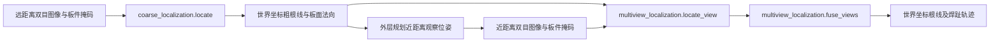

# 两阶段双目焊缝定位功能包

当前流程分为两个可单独导入的 Python 包，主入口 `main.py` 已使用这两个包。

| 功能包 | 输入 | 输出 |
| --- | --- | --- |
| `weld_vision.coarse_localization` | 一组远距离双目图像、两个板件掩码、双目标定和左目位姿 | 世界坐标粗根线、两个板面法向、距离和测量检查信息 |
| `weld_vision.multiview_localization` | 粗定位结果、多组近距离双目图像、各组标定、掩码和位姿 | 各视角根线及焊趾、多视角融合根线和焊趾、有效区段、支持视图数和视角间偏差 |

这两个包复用现有的双目视差平面拟合与焊趾提取算法。阵列接口不读取场景、CAD、真值或机器人模型，也不调用仿真器和 SAM；板件掩码由调用方提供。现有在线流程仍由 `main.py` 调度图像采集、SAM3.1 分割、定位和结果保存。



## 1. 输入约定

每次阵列接口调用接收以下数据：

- `left, right`：完成双目校正的同尺寸 NumPy 图像，支持灰度或 RGB。
- `intrinsics`：校正后左目的 `3×3` NumPy 内参矩阵，像素中心采用整数索引约定。
- `baseline`：正的双目基线长度，单位米。校正后右相机位于左相机的正 X 方向。
- `mask_a, mask_b`：与校正后左目图像同尺寸的两个布尔板件掩码；可以来自 SAM3.1 或其他分割器。
- `world_from_left`：`4×4` 刚体变换，表示**校正后左目光学坐标系到公共世界坐标系**，平移单位米。光学坐标为 X 向右、Y 向下、Z 向前。

两阶段的全部位姿必须使用同一世界坐标系。仅有左右图像不足以产生可跨视角融合的米制世界坐标轨迹；还需要双目标定和各视角位姿。接口会拒绝缩放矩阵等非刚体位姿。

已有采集数据可用 `weld_vision.stereo_io.load_pair(input_json, masks)` 校正图像与掩码，并转换像素中心约定。返回的 `original_from_rectified` 旋转需要右乘到原始左目位姿的旋转部分。项目仿真标定默认像素中心为 `i + 0.5`；使用 OpenCV 整数像素中心标定时应传 `half_pixel_centres=False`。

`calibration/hj90_rgb_vendor.json` 描述独立 RGB 相机，不能提供左右目内参、畸变和相对外参。真实相机接入时，应使用真实双目标定以及相机到机器人/世界坐标的外参；`hj90_sim.json` 是当前仿真双目参数。

## 2. 远距离粗定位

```python
from weld_vision import coarse_localization as coarse

observation = coarse.locate(
    far_left, far_right, far_k, far_baseline,
    far_mask_a, far_mask_b, far_world_from_left,
    ident="overview_01",
)
if observation["status"] != "ok":
    raise RuntimeError(observation["status"])
```

`locate` 的工作包括双目匹配、两个板面的拟合、平面交线求解、可见根线端点确定和世界坐标变换。成功结果包含：

| 字段 | 含义 |
| --- | --- |
| `status` | `ok` 或测量失败原因 |
| `root_world_m` | `2×3` 根线端点，单位米 |
| `face_normals_world` | 两个朝向可见板面的世界坐标法向 |
| `estimated_range_m` | 相机中心到根线中点的距离；可通过 `range_origin_world` 指定测距原点 |
| `checks` | 双目匹配和平面拟合诊断 |
| `seam` | 原始单组双目测量，包含相机坐标几何、拟合参数和图像坐标 |

默认 `depth_range=(1.4, 2.7)`，可按相机配置调整；该值是匹配深度搜索范围。`require_t_joint=True` 会增加当前工位使用的 T 接头几何检查，要求世界坐标 Z 向上；通用阵列接口默认关闭该限制。

## 3. 近距离多视角定位与融合

```python
from weld_vision import multiview_localization as near
from weld_vision.bead_seam import polyline_segments

# near_inputs 中每个元素依次为 left, right, K, baseline, mask_a, mask_b, world_from_left。
views = [
    near.locate_view(*inputs, observation, ident=f"near_{index}", mode="bead")
    for index, inputs in enumerate(near_inputs)
]
fused = near.fuse_views(views, minimum=2, mode="bead")
if fused["status"] == "ok":
    root_endpoints = fused["root"]["ends"]
    toe_segments = [polyline_segments(toe) for toe in fused["toes"]]
```

实际下发连续轨迹时，应按每条焊趾的 `valid` 掩码分段，避免跨过未观测区段连接端点。可用 `weld_vision.bead_seam.polyline_segments(toe)` 得到连续有效折线。

`locate_view` 对每个近拍视角独立进行双目拟合和精定位，转换到公共世界坐标，并检查测得根线是否与粗定位一致。默认近拍搜索范围为 `depth_range=(0.20, 1.50)`；与粗定位根线偏差超过 8 cm 或方向差超过 10° 时返回 `inconsistent_with_overview`。重复纹理引起歧义时，可通过 `expected_distance` 提供距离先验；先执行无先验匹配，仅在歧义状态下重试。

- `mode="bead"`：已有焊道接头，提取根线及两侧焊趾。
- `mode="root"`：裸接头，提取和融合根线。

调用方明确指定模式；当前接口不自动判断是否已有焊道。`fuse_views` 的模式须与逐视角定位一致，不允许混合融合。

逐视角成功结果包含 `root`、`normals`、`toes` 和 `checks`。`fuse_views` 忽略失败视角，拒绝重复的非空视角 ID，默认要求至少两个视角支持。融合结果保留 NumPy 数组，主要字段为：

| 字段 | 含义 |
| --- | --- |
| `status` | `ok`、`partial` 或 `insufficient_views` |
| `root.ends`、`root.view_used` | 融合根线端点和采用的视角掩码 |
| `toes[i].xyz`、`toes[i].s_m` | 沿根线重采样的焊趾坐标和里程，默认采样间隔 1 mm |
| `toes[i].valid` | 满足支持视图数等检查的有效点掩码 |
| `toes[i].views`、`toes[i].spread_m` | 各采样点的支持视图数和最大偏差 |

`ok` 表示两条焊趾都具有至少两个有效采样点，不承诺全长连续覆盖。根线模式的 `toes` 为空。视角数量不足时结果仅含失败状态和可用数量，不含轨迹。普通测量失败通过 `status` 返回；非法参数或不一致的融合输入抛出 `ValueError`。

## 4. 已保存数据与主入口

为保留当前实验数据格式，两个包还提供文件适配接口：

```python
from pathlib import Path
from weld_vision import coarse_localization as coarse
from weld_vision import multiview_localization as near

# overview_view、close_plan 来自现有采集计划。
run = Path("outputs/benchmarks/20261116_02__stereo__A25-A26_front__sweep")
observation = coarse.measure_overview(run, overview_view)
predictions = near.measure(run, Path("outputs/runs/my_two_stage_run"),
                           plan=close_plan, station="A25", minimum=2)
```

`measure_overview` 读取整体双目采集与 SAM 候选，选择板件对，调用粗定位并返回可序列化记录；识别失败时抛出异常以终止当前工位。

`measure_close` 读取单个近拍视角，以粗根线和板面法向帮助选择对应板件；`measure` 读取近拍计划中的粗定位记录，逐视角测量并融合，输出原有的 `predictions.json`、`fused.json`、根线/焊趾 CSV 和整体观察叠加图。只有标为 `sweep` 且测量成功的视角参与该文件流程的融合。独立阵列接口 `fuse_views` 可用于其他视角组织方式。

`export_fusion(output, station, views, minimum, mode="bead")` 可单独将逐视角阵列结果写为现有 JSON/CSV 格式。焊趾命名中的 `base`/`web` 沿用当前 Z 向上工位约定；通用阵列结果以两个板面的顺序索引焊趾。

`main.py` 继续负责命令行、运行检查、进程调度和运行报告。相机采集、SAM 模型加载、机器人运动学、碰撞检查和近拍位姿规划保留在外层。当前仿真初始远拍瞄准仍使用已知工位区域，近拍位姿根据粗测根线和板面法向规划；这次封装没有增加未知场景的全局搜索能力。

现有 `weld_vision.sweep` 保留兼容导入，已有实验工具可以继续使用。两个功能包目前随项目导入，尚未分别发布为独立 wheel 或 ROS 节点。

## 5. 验证

`tests/test_localization_packages.py` 使用合成双目场景验证两个阶段在平移、旋转后的公共世界坐标中协同工作，并检查多视角支持、重复视角、裸接头模式、失败状态传递和无模型/仿真运行时导入。

A25、A26 保存数据可通过主入口 CPU 回放，检查封装前后融合 JSON 是否逐值一致。该回放验证既有图像、标定和 SAM 掩码的测量链路；不重新渲染或执行 SAM 推理。

2026-11-17 验证结果：完整单元测试 69 项通过，A25、A26 均成功融合 7 个扫查视角，两个工位的 `fused.json` 与封装前逐值一致。日志、回放结果与比对记录见 [两阶段封装验证](../outputs/validation/20261117_02__maintenance__pipeline__two_stage/README.md)。
