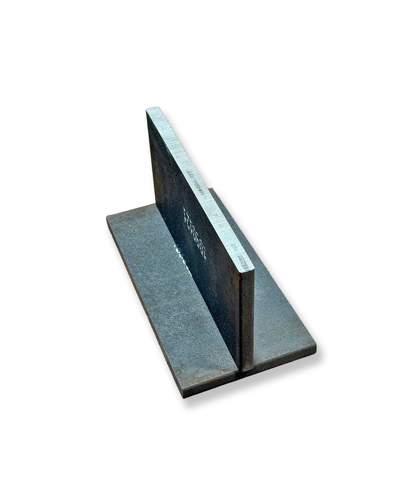
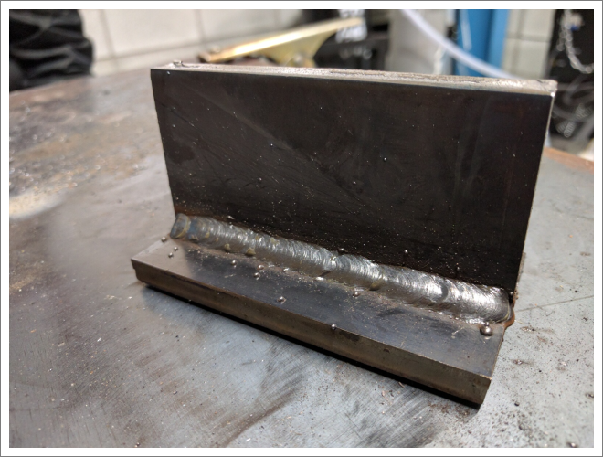
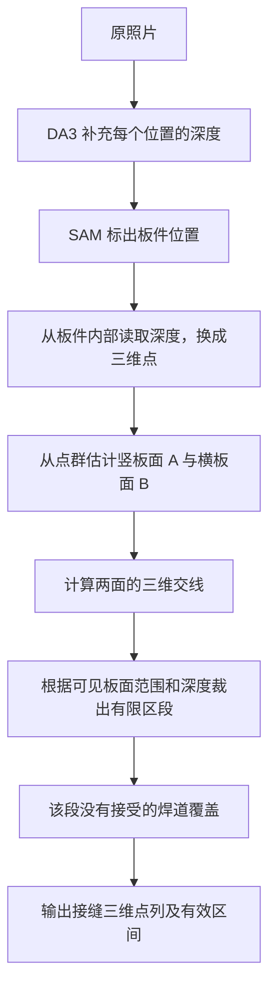
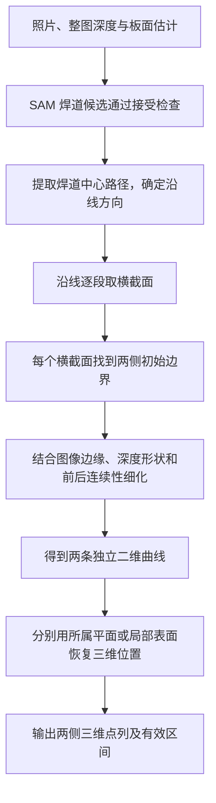

# 一张图片如何变成三维焊缝：SAM3 与 DA3 完整流程

更新日期：2026-10-19。

12 张原始图片的数量、逐张效果与原图对照见 [识别效果总览](weld_image_results.md)。

这份说明从一张工件照片进入程序开始，跟着数据走到三维曲线输出。前面先讲每一步拿到什么、做了什么，以及为什么能交给下一步；公式、阈值和字段放在最后的附录中。

## 1. 先看我们最终想得到什么

假设桌面上放着两块组成 T 形接头的板：一块横放，另一块竖在上面。相机从斜前方拍下照片，能同时看见横板、竖板和两者的交接位置。

如果这个位置还没有形成可识别的焊道，我们希望沿两块板相接的位置得到一条三维接缝候选。如果这个位置已经有一条焊道，我们希望沿已有焊道与两侧表面接上的位置，分别得到两条三维边缘候选，供下一道沿边缘焊接时定位。

最终结果是一串按顺序排列的空间点。每个点除了有照片里的位置，还具有相对于相机的 X、Y、Z 坐标。遮挡、模型不确定或三维位置跳变的地方会断开，不能把这些断点两端直接连接。

下面两张现有图片分别帮助理解这两种情况。它们来自不同工件，不是同一工件的焊前、焊后配对照片。

**例图 A：从板面关系寻找交接位置。**



**例图 B：沿已有焊道寻找两侧边缘。**



阅读后文时，可以一直保留这幅场景：我们面对的是照片里的同一个接头，程序正在逐步补齐它的位置和形状信息。

## 2. 照片进入程序，先补上每个位置的距离

用户把照片交给 `scripts/auto_weld.py`。程序读取照片，记住原始宽高，随后对它运行 DA3。实际模型进程依次执行，DA3 在前，SAM3 在后；下文也按这个顺序说明。

照片最初只有颜色。假设照片中有一个像素落在横板上，这个像素能告诉我们“这个地方看起来是什么颜色”，但单凭像素坐标，还无法知道它在相机前面多远。相同的图像位置可能对应视线方向上不同距离的点。

DA3 对整张照片预测距离，得到一张与处理后照片对应的深度图。可以把它理解为：原先每个位置只有颜色，现在每个位置又多了一个估计的远近值。DA3 同时给出把图像位置换成空间视线方向所需的相机内参，并在可用时给出深度置信信息。

此时仍没有找出焊缝。横板、竖板、桌子和背景都可能有深度，程序只是初步知道了照片里各处的空间远近。下一步还要识别哪些位置属于工件，哪些位置像焊道。

**此时交给下一步的是：原照片、对应的深度图，以及图像位置与空间方向之间的换算信息。** 当前这些距离和内参都来自模型估计。

## 3. SAM3 在照片上标出板件和可能的焊道

接着，程序把同一张原照片交给 SAM3。它会自动使用 `metal plate` 寻找板件，再使用 `weld` 和 `weld bead` 寻找可能的焊道。用户不用逐张写提示，也不用画框或点选。

SAM3 的结果可以理解成覆盖在照片上的选区。例如，照片中的竖板可能被一个选区覆盖，横板被另一个选区覆盖。如果它认为交接处有焊道，还会给出覆盖焊道的选区。代码里把这种与照片位置对应的选区叫作“掩码”。

对于例图 A，期望得到的主要信息是哪些像素属于板件。对于例图 B，除了板件，交接处还可能多出一个细长的焊道选区。这些结果都先作为候选保留，后面还要结合形状和空间位置判断。

现在，DA3 和 SAM3 的结果可以在同一位置对上：某个像素在 SAM 的竖板选区内，程序就可以到深度图的相应位置读取它的距离。处理时会把选区与 DA3 使用的图像分辨率对齐，最终再把曲线位置映射回原照片。

这就是两模型之间的实际配合：**SAM3 指定从哪里取数据，DA3 提供这些位置的估计距离。** 当前没有把几个选中的点再传入 DA3 单独推理；DA3 已经预测了整张图。

在这一步可以直接查看 [SAM3 焊道选区](../outputs/offline/depth_anything_3/data/sam_weld_overview.jpg) 和
[SAM3 工件选区](../outputs/offline/depth_anything_3/data/sam_plate_overview.jpg)。这些图保留了本轮返回的全部候选，后续板面和焊道过滤还没有作用到它们。

## 4. 从板件选区中取点，把照片里的板变成空间中的点群

现在先继续跟着例图 A。程序知道哪些位置属于板件，也知道这些位置的估计距离，接下来就能把它们换成空间点。

可以把一个像素想成从相机出发的一条视线。相机内参确定视线的方向，深度确定这个点沿视线的相应 Z 位置。两者结合，就把“照片第几行、第几列上的一个点”转换成“相机前方的一个三维点”。

对竖板选区中的许多像素重复这个过程，会得到一群大致排成竖板形状的空间点；对横板选区重复操作，也会得到一群横板上的空间点。程序到这里才开始具备用空间几何判断板面关系的条件。

取点时，程序优先使用板件内部。板边附近可能同时混入前后两个物体的深度，因此会缩小取样区域，避开掩码边界；可能的焊道区域也先排除，因为焊道的凸起不能当作平整母材的一部分。较低置信的深度点也会被排除。

如果 SAM 没有给出板件选区，程序会尝试全图几何回退，并在报告中记录来源；如果有选区但取不到足够的可靠点，该区域可能无法继续拟合。

**这一步得到的是属于各个板件的空间点群，还没有得到完整、平滑的板面。** 点群里会有噪声，下一步要从中估计板面。

## 5. 从点群估计板面，确定每一块面的方向和位置

真实照片对应的预测点不会整齐地落在同一张平面上。有些点略高，有些略低，还可能混入其他表面。因此，程序需要从大部分相互一致的点中估计板面。

可以把这个过程想成拿一张平纸去贴合点群：换几个位置和方向，看看哪种摆放方式能让最多的点靠近这张纸。选出较好的结果后，再用这些支持点细化纸的位置。代码使用随机候选、点到平面距离和局部朝向检查来完成这件事。

这里的“局部朝向”来自邻近三维点构成的小面。例如，竖板内部相邻点形成的小面大致朝向相同，横板内部的小面朝向则不同。代码中把表面朝向记为“法向”，它帮助程序把属于不同面的点分开。

同一个 SAM 选区可能覆盖一整件折弯零件，这个零件本身就有几个不同朝向的面。程序找到一个面后，会继续在剩余点中寻找其他面，所以不会把“一个板件选区”强行当成“一个平面”。

对于前面的 T 形例子，我们希望获得竖板的可见面 A 和横板的可见面 B。每个面现在都有一个数学描述，包含它在空间中的朝向与位置，以及哪些预测点支持这个描述。

**有了面 A 和面 B，程序就能进一步计算两者延长后在哪里相交。**

## 6. 找到两块板实际相接的可见区段

两张不平行的平面延长后会相交成一条直线。程序计算这个交线，得到交接位置在空间中的候选方向和位置。

但是，照片里的板件有边界。即使两张延长平面相交，交线也可能落在工件之外；场景中还可能有桌面、其他板件和板子的外轮廓。程序因此会检查交线附近是否真的有两个板面的支持区域，两者是否靠得足够近，以及表面关系是否符合当前要找的可见凹角接触。

程序还会把三维交线投回照片。假设交线认为某个位置应当落在工件前方，但 DA3 在对应像素给出的距离却明显不同，这个位置就缺少支持。结合两侧板面在照片中的范围和深度一致性，程序裁出有依据的起止区段。

最后还会查看交线附近哪里出现连续的表面朝向变化。如果估计交线与可见的转折位置偏离较大，对应点会标为几何不确定。

这一步形成的是一个**有限的三维交接线候选**。它的空间点由两个拟合平面的交线确定，DA3 在交接处的原始深度用于检查。这样能够保留估计平面的整体几何约束，减少逐点深度噪声对曲线的影响。

对于例图 A，如果交接处没有被接受的焊道覆盖，程序就已经具备了接缝分支所需的三维定位结果。接下来还要结合 SAM 的焊道候选决定哪些区段保留这条交线。

## 7. 检查 SAM 给出的焊道候选，决定后面使用哪种定位结果

此时程序同时拿着两类信息：一类是刚才算出的板面和交接线，另一类是 SAM 认为“这里可能有焊道”的选区。现在才开始把它们联系起来。

SAM 可能把细长反光、划痕或其他结构圈成焊道。程序先检查选区是否有足够的面积、长度和细长形状，再看它的模型分数，以及它是否落在几何交接线附近。

如果候选本身的语义分数较强，程序允许它在没有可靠根部交线时继续进入边缘提取。因为已有焊道可能遮住根部，板面的完整交线不一定还能恢复出来。后面的边缘三维检查仍然会继续进行。

通过这些检查后，程序会得到“接受的已有焊道候选”。没有通过长焊道检查的小点焊或弱候选，也可能作为不确定证据保留。

接下来分别走完两种情况：例图 A 的交接处没有接受的焊道，保留接缝定位；例图 B 有接受的焊道，需要沿已有焊道找两侧边缘。

## 8. 情况 A：没有接受的焊道，交线怎样成为最终接缝候选

继续例图 A。程序已经知道面 A、面 B 的位置，已经计算出交线，也已经裁出了两侧板面都能支持的可见区段。如果这一段没有接受的焊道覆盖，就把该段交线放入接缝输出。

输出时，交线沿长度方向取样，每个采样点都同时具有照片坐标和相机坐标。照片坐标用于画图检查是否贴合接缝，相机坐标用于表达这条线在三维空间的位置。

某一段如果存在弱焊道或点焊证据，程序会把这段单独保留为不确定状态。某一段如果与深度或可见转折不一致，则对应点不通过几何检查，连续有效区间会断开。

因此，对于一个完整、清楚的直角接头，这条路线从头到尾是：



程序给这段记录的含义是“未检出焊道，使用交线候选”。制造状态仍然保持未知，因为 SAM 可能漏检。当前数据中的 `seam_03` 就说明了这种情况：真实可见焊接痕迹没有被完整识别，几何分支仍可能给出交线。

对于被遮挡的端点或超出图像的部分，当前输出只覆盖有依据的区段，不会因此恢复整个工件上不可见的完整接缝。

## 9. 情况 B：接受了已有焊道，怎样沿两侧边缘得到两条三维曲线

现在看例图 B。SAM 给出了横板与竖板交接处的一条细长焊道区域。下一道希望沿已有焊道的边缘走，因此程序需要找出这条焊道沿长度方向的两侧边界。

### 9.1 先确定沿焊道前进的方向

焊道选区是一片有宽度的区域。程序先把它细化成骨架，再从骨架中提取一条主要的中心路径。

这条中心路径用来给整条焊道建立方向。沿它走，程序能知道现在走到焊道的哪一段，以及这一段的局部前进方向。中心路径在这里用于组织后面的搜索。

### 9.2 沿长度方向逐段横着切，看清两侧边界

程序沿中心路径隔一小段取一个位置，再在该位置沿垂直于前进方向的方向横着搜索。可以把它想成在照片上放一根横跨焊道的短尺。

短尺中间落在焊道选区内。向一侧移动，第一次离开选区的位置就是这一侧的初始边界；向另一侧移动，也能得到另一侧的初始边界。沿整条焊道重复，就得到一串一侧边界点和一串另一侧边界点。

示意图只表达图像中的横向扫描关系：

```text
                 沿焊道方向前进
                       ↓
                     中心路径
                        │
  一侧表面 ── 初始边界 A ── 焊道区域 ── 初始边界 B ── 另一侧表面
                        │
                   下一处横截面
```

这些点仍然只是 SAM 选区的边界。SAM 可能把一小块反光算进焊道，也可能漏掉部分真实焊趾，因此还要在附近细化位置。

### 9.3 在初始边界附近，找焊道真正接上周围表面的地方

以一侧初始边界为例，程序向外取一些深度点，了解这一侧周围表面的形状，再在初始边界附近尝试几个位置。

对每个位置，程序同时看三个变化：照片颜色或纹理是否有边缘，三维表面朝向是否发生变化，以及表面是否开始偏离这一侧的母材平面。焊道从平板上隆起的位置，通常会在这些信息中表现出一定变化。

如果只取每个横截面里变化最强的位置，一条规则可能在某处选中焊趾，在下一处却选中焊纹或反光。程序因此把相邻横截面一起考虑：每一处既要有边缘证据，也要与前后位置连接自然。离 SAM 初始边界过远、横向突然跳动的位置会受到限制。

同样的处理在另一侧独立执行。到这里，程序得到两条已经细化的二维开放曲线，分别沿已有焊道两侧延伸。掩码中间缺失的地方会分段，两端保持分开。

### 9.4 已经找到照片里的两条边，接着确定它们在空间中的位置

现在取曲线 A 上的一个像素。程序知道它位于照片哪里，也能确定从相机出发、穿过该像素的视线方向，但还需要确定这条视线上哪一点对应真实边缘。

如果曲线 A 接着的是平整母材，前面拟合的板面可以提供约束。程序计算这条视线与所属板面的交点，把交点作为边缘的三维估计，再与该像素的 DA3 深度比较。两者明显不一致时，这个平面估计不能直接接受。

对曲线 A 的其他像素重复操作，就得到这一侧的三维点列。曲线 B 使用它自己一侧的承接表面，同样形成另一条三维点列。因此，两侧可以具有不同的表面朝向与三维形状。

### 9.5 边缘旁边已经是另一条焊道时，用局部表面估计

多层、多道焊时，当前边缘旁边可能已经不是平整板面，而是上一道焊道的弯曲表面。如果始终把这些边缘点压到原始母材平面上，三维位置可能发生偏移。

程序因此还会在每个边缘点附近，利用边界外侧的深度样本估计一小块承接表面。先尝试局部平面，再检查稍微弯曲的模型能否更好地解释这些点。

检查时会留出部分样本，不用它们拟合，而是让拟合结果预测这些样本的深度。只有弯曲模型的预测确实更好，并且边缘处预测深度仍与 DA3 相符时，才采用局部曲面。

这样每个边缘点都有来源记录：来自母材平面、局部平面、局部曲面，或者目前只有未确认的原始深度。某个位置没有通过检查时，仍可以保存它的候选位置，但不能把它算进连续有效曲线。

对于已有焊道，这条路线从头到尾是：



## 10. 一条接缝只有一部分焊过时，怎样把结果组织起来

前面把两种情况分开讲，是为了把每条路线走清楚。真实图片里，一条接缝可能同时包含未检出段、小点焊、连续焊道，以及遮挡段。

程序会沿每条几何交线检查覆盖关系。在某一段，如果已接受的焊道覆盖了交接位置，就记录它与该焊道的关联；这一段的定位结果使用已有焊道的两侧边缘。其余区段继续保留交线候选。弱候选覆盖的位置则单独标为不确定。

例如从左到右可能得到：

```text
接缝左端       一小段点焊           连续焊道                接缝右端
   │               │                   │                       │
   └─ 交线候选 ── 不确定区段 ── 焊道 A/B 两侧曲线 ── 交线候选 ──┘
```

这些区段分别保存，所以局部焊道不会盖掉整条接缝的其他部分。程序仍未自动决定下一次要焊哪一侧、先焊哪一段，也没有把不同候选连接成完整执行路线。

还有一种情况：SAM 对已有焊道的识别足够强，但根部交线被遮住，几何分支没有形成交线候选。这条焊道仍可进入两侧边缘提取，其三维点继续接受表面和深度检查。

从代码执行顺序看，板面和交线先计算，焊道候选随后接受过滤；被接受的焊道先计算两侧边缘，再沿各条交线切分状态，最后统一组织输出。

## 11. 输出前处理不确定点，避免把三维断点连接起来

即使一条线在照片上看着连续，它在三维中也可能有问题。例如模型在两个局部表面之间切换时，相邻像素对应的三维坐标可能突然跳远；某一段的深度也可能没有足够的形状证据。

程序会检查边缘附近是否有深度变化依据、所选表面是否与预测深度一致、该位置的深度置信是否可用，以及相邻三维点是否连续。接缝交线则检查深度一致性与可见转折位置的偏离。

未通过检查的点会保留标记，程序把其余连续点分成多个有效区间。例如一条候选曲线的中间有异常点，输出可能是前半段有效、异常处无效、后半段有效。后续读取时必须保持这种分段关系。

检查图里的黄色点就是这类待确认位置。图上“多少点通过检查”的比例表示这些规则的通过情况，不能解释为真实工件上的定位准确率。

## 12. 最后交付的结果，以及用户怎样查看

经过前面的步骤，程序会把三类信息一同保存：曲线在照片中的位置、曲线在相机坐标系中的位置，以及哪些区段具有当前模型提供的几何支持。

首先查看 [全图汇总](../outputs/offline/depth_anything_3/auto_overview.jpg)，确认程序关注的是目标工件的交接处。再查看 [已有焊道边缘图](../outputs/offline/depth_anything_3/weld_toes_overview.jpg)，检查两侧曲线是否沿着希望继续焊接的位置。青色和品红色是两侧候选，黄色点需要检查。

随后从 [统一路径表](../outputs/offline/depth_anything_3/seam_paths.csv) 或 `data/` 中的 JSON、NPZ 取出三维曲线。每条曲线、每个连续有效区间分别读取，不能跨越无效点直接连接。具体字段见附录 C。

最终三维坐标相对于相机：X 向右，Y 向下，Z 向前，单位为米。这些坐标描述的是“相机看见的边缘在哪里”。要让焊枪沿它走，还需要相机到机器人坐标变换、选择目标边缘、确定工艺偏移和焊枪姿态，再进入机器人轨迹规划。

**当前已经完成的主线是：从照片定位板件和焊道，用深度恢复板面关系或焊道两侧表面，最终输出带有效区间的三维候选曲线。**

## 13. 把两条完整路线再串起来

对没有接受焊道的直角接头，照片先经过 DA3 得到各处深度，再经过 SAM 得到板件选区；程序从选区内取出空间点，拟合两个接触面，计算它们的三维交线；根据可见板面范围和深度裁剪交线，确认该段没有接受的焊道覆盖，再把连续有效区间作为接缝候选保存。

对已有焊道，程序先获得相同的深度和板面基础，再接受 SAM 的焊道区域；沿焊道中心路径逐段横向寻找两侧边缘，结合图像与深度形状细化；然后分别利用两侧所属的平面或局部曲面确定空间位置，检查断点，最后保存两条独立的三维边缘候选。

这两条路线共享同一张图片的模型结果和板面估计。在同一条接缝只有部分焊过时，程序把它们按区段同时保留。

---

## 附录 A：运行入口与代码位置

在项目根目录执行：

```bash
conda activate depth-anything-3

# 单张图片
python scripts/auto_weld.py assets/weld_images/tacked_front_01.jpg

# 整个目录，各图独立处理
python scripts/auto_weld.py assets/weld_images

# 可选：保存模型结果，便于之后只复跑数学处理
python scripts/auto_weld.py assets/weld_images --model-cache-dir /tmp/quadweld_auto_models
```

| 文件 | 负责的流程 |
| --- | --- |
| [scripts/auto_weld.py](../scripts/auto_weld.py) | 读取图片、调用模型、组织区段及结果输出 |
| [scripts/predict_depth.py](../scripts/predict_depth.py) | 整图深度和相机内参预测 |
| [vision/weld_detector.py](../vision/weld_detector.py) | 板件内部采样、板面拟合、交线与区段状态 |
| [vision/weld_toes.py](../vision/weld_toes.py) | 沿焊道取横截面、细化两侧边界、选择三维估计 |
| [vision/weld_surfaces.py](../vision/weld_surfaces.py) | 局部表面估计和三维连续性检查 |

当前模型是本地 SAM3.1 multiplex 与 DA3NESTED-GIANT-LARGE-1.1。SAM 默认初始阈值为 `0.25`，固定提示为 `metal plate`、`weld`、`weld bead`；DA3 后处理长边约为 504 像素。模型权重获取方式见 [项目 README](../README.md)。

默认使用同级 `sam3` Conda 环境，可用 `--sam-python` 指定。`--gpu auto` 选择空闲显存最多的 GPU，`--output-dir` 修改汇总目录。

可选模型缓存校验图片 SHA256；SAM 缓存还校验阈值及输入顺序。更换权重或推理设置时应更换缓存目录。

## 附录 B：关键计算与当前阈值

### B.1 把深度像素换成三维点

$$
r(u,v)=K^{-1}[u,v,1]^\top,\qquad P(u,v)=D(u,v)\,r(u,v)
$$

$K$ 是处理后分辨率下的相机内参，$D$ 按光轴 Z 深度使用。原图坐标导出时采用像素中心换算，内参与深度始终在处理后图像上配套使用。

### B.2 两平面的三维交线

$$
n_1^\top X+d_1=0,\qquad n_2^\top X+d_2=0
$$

$$
v=\frac{n_1\times n_2}{\|n_1\times n_2\|},\qquad L(t)=P_0+t\,v
$$

代码保存 $P_0$ 与 $v$，并沿交线投影取样，通过像素射线与平面求交取得三维点。这些点同时落在两个估计平面上。

### B.3 边缘射线与母材平面求交

$$
X=-\frac{d}{n^\top r}\,r
$$

分母接近零、交点在相机后方或与 DA3 深度明显不一致时，该平面交点不能接受。

### B.4 弯曲承接面的局部估计

以局部横向、沿线坐标 $(s,t)$ 比较线性与二次逆深度模型：

$$
\frac{1}{Z}=a_0+a_1s+a_2t
$$

$$
\frac{1}{Z}=a_0+a_1s+a_2t+a_3s^2+a_4st+a_5t^2
$$

使用稳健重加权最小二乘，并留出约四分之一的样本验证。只有二次模型留出误差明显更小，且线性误差具有足够幅度时，才选择曲面。

### B.5 参数查阅表

以下均为当前代码中的启发式参数，尚未按实机焊接精度验收。

| 位置 | 当前条件 |
| --- | --- |
| 板面采样 | 板件掩码 `5×5` 腐蚀；可能焊道 `5×5` 膨胀后排除 |
| 深度置信 | 排除非有限值与低于本图第 10 百分位的值；无置信图时不执行该筛选 |
| 板面拟合 | 每轮 400 个假设；每个实例最多 16 轮；法向约 15° 内一致 |
| 板面距离 | 点到平面距离小于约 Z 的 `0.4%` |
| 板面对 | 急夹角至少约 `25°`；检查有限邻接及可见凹角 |
| 交线一致性 | 与 DA3 深度差约小于 `3.5%`；法向观察曲线偏离不超过约 5 个处理像素 |
| 接受焊道 | 形状过滤后，分数至少 `0.4` 且交线附近支持比例至少 `20%`，或分数至少 `0.65` |
| 焊道截面 | 沿线间隔约 1.5 个处理像素；宽度至少约 3 像素；至少 8 个连续有效截面 |
| 边缘细化 | 半径为宽度约四分之一，限制在 2～5 个处理像素；搜索步长 0.5 像素 |
| 连续边界 | 相邻截面横向偏移变化不超过约 3 像素，另有连续性惩罚 |
| 外侧取点 | 距初始边界约 3、4、5、6、8 个处理像素 |
| 平面三维边缘 | 正深度，且与 DA3 深度差小于约 `3%` |
| 局部表面 | 最多附近 15 个截面；至少 30 个有效样本；四轮稳健重加权 |
| 曲面选择 | 二次模型留出误差小于线性模型的 `70%`，且线性误差大于约 Z 的 `0.02%` |
| 局部表面检查 | 留出误差不超过约 Z 的 `0.4%`，拟合 RMSE 不超过约 `0.6%`，边缘 Z 差小于约 `3%` |
| 三维跳点 | 阈值取局部典型步长 5 倍与中位 Z 的 `0.3%` 中较大者 |

二维边缘评分包含法向变化、RGB 边缘、平面残差变化和距 SAM 初始边界的先验；相邻横截面通过动态规划共同选择。评分权重与其他更细参数可在上述代码文件中查阅。

## 附录 C：结果字段与读取方式

所有图片汇总到 `outputs/offline/depth_anything_3/`，不为每张图片创建目录。
从 [结果目录说明](../outputs/offline/depth_anything_3/README.md) 查看；根目录保留两张结果图和统一路径表，详细数据放在 `data/`。
复跑更新当前结果和目录说明；早期单图深度及手工几何实验保留在 `archive.zip`。

| 文件 | 用途 |
| --- | --- |
| `auto_overview.jpg` | 检查全图选中了哪些焊道和交接位置 |
| `weld_toes_overview.jpg` | 检查两侧曲线、未确认点与横截面证据 |
| `seam_paths.csv` | 读取两个分支统一导出的三维候选 |
| `data/weld_toes.csv` | 检查焊趾原始、平面及表面坐标与各项标记 |
| `data/auto_results.npz` | 深度、内参、掩码、板面和曲线数组 |
| `data/auto_report.json` | 曲线索引、区段状态、关联关系、有效区间和来源 |

单独运行深度推理或手工选区分析时，默认输出也收在 `data/`，避免把辅助文件堆回根目录。

报告格式为 `schema_version=2`。每张图的 `planes` 保存板面，`joints[].segments` 保存接缝区段，`welds[].toe_segments` 保存焊道两侧曲线，`paths` 保存统一导出的候选曲线索引。

| 状态 | 含义 |
| --- | --- |
| `no_weld_detected` | 未检出焊道，使用交线候选；制造状态未知 |
| `uncertain_weld_evidence` | 有弱候选或小点焊等证据，尚未接受为完整焊道 |
| `weld_detected` | 接受的焊道候选覆盖，关联其两侧边缘 |

`paths` 的 `xy_key` 指向原图坐标数组，`xyz_key` 指向三维坐标数组，`geometry_key` 指向逐点有效标记。交线的三维坐标来自解析交线；焊趾的统一三维坐标来自选择的平面或局部表面估计。

焊趾点的 `geometry_supported` 综合深度形状依据、表面一致性、深度置信和三维连续性。表面来源 `surface_kind` 为 `0` 未确认原始点、`1` 母材平面、`2` 局部平面、`3` 局部二次曲面。无效位置可能保留原始点和占位误差值，必须结合标记读取。

`paths[].geometry_runs` 保存连续有效点的半开区间 `[start_sample, stop_sample)`。在 CSV 中，按 `image,path_id,geometry_run` 分组，排除 `geometry_run=-1`，按 `sample` 排序。不同组分别形成曲线，不直接连接。

所有三维坐标采用相机光学坐标系，单位米；像素坐标对应原图。A/B 是根据当前有序中心路径定义的两侧编号，不保证跨视角对应同一个物理侧。

## 附录 D：验证记录与尚未完成的部分

2026-10-18 的 12 张现有图片复跑中，5 个已接受焊道区域都得到成对边缘；统一表保存 32 条候选和 3,808 个采样点。候选数包含局部区段和可能的多余结果，不等于真实焊缝数量。

当前 `seam_03/04` 尚未恢复完整焊道区域，`seam_05`、`unwelded_02` 没有候选输出。`welded_02` 有些位置需要局部表面估计或仍未确认；`welded_front_02` 一侧的部分形状证据较弱。

已完成原图坐标、三维重投影、双平面交线残差、分段区间和 CSV 对应关系检查，25 项测试通过：

```bash
python -m unittest tests.test_auto_weld tests.test_weld_toes tests.test_weld_geometry -v
```

这些检查验证程序与数学关系是否按预期工作。当前没有完整焊趾真值，尚未验证毫米级实际定位精度。拟合残差小只说明表面模型较好地解释了 DA3 预测；例如 3% 的深度一致性在 Z 为 1 米时对应 30 毫米，不能作为焊接允许误差。

现阶段还受这些条件限制：SAM 会漏检或误检；反光、遮挡和深度平滑会影响 DA3；约 504 像素的处理分辨率限制细小焊趾；共面对接、明显间隙、复杂坡口和分叉结构需要进一步处理。局部曲面模型尚未识别焊接层数或焊道编号。

后续从候选曲线进入实际再焊，还需要完成相机及机器人标定、目标区段和边缘选择、工艺偏移、焊枪姿态、轨迹可达性与碰撞检查，再接入执行控制。
